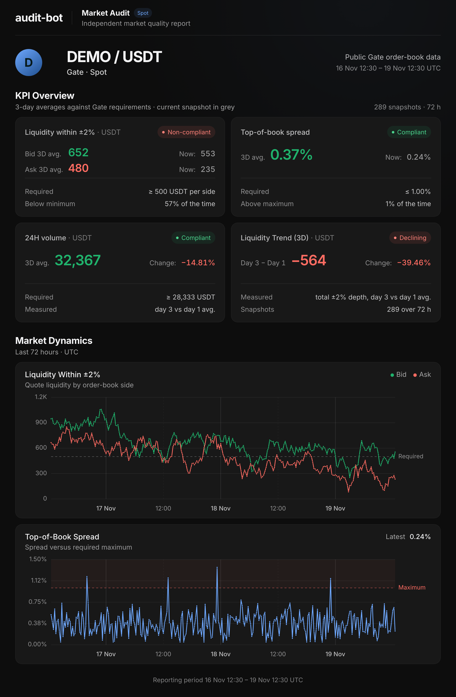
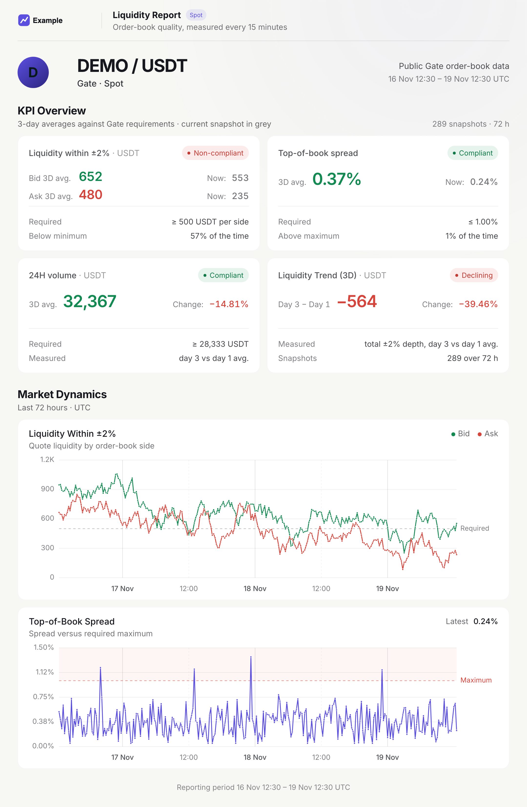

# audit-bot

A Telegram bot that audits a token's market quality on centralised exchanges. Send it a CoinGecko or
CoinMarketCap link; it finds every supported exchange the token trades on, snapshots each one's public order
book every hour (or every 15 minutes, `AUDIT_CADENCE_MIN`) for 72 hours, then sends one PNG card per exchange, judged against that exchange's
market-making requirements, plus a suggested message to the project. A small HTTP API serves the same cards
to other systems.

| Default theme | A custom brand (`examples/brand/`) |
|---|---|
|  |  |

Both cards are rendered from made-up data by `examples/demo.py`. Public exchange endpoints only, no API keys;
Python standard library plus Playwright for the screenshot.

## Try it

```bash
python3 -m venv .venv && .venv/bin/pip install -r requirements.txt && .venv/bin/python -m playwright install chromium
.venv/bin/python examples/demo.py                                    # writes demo-card.png
.venv/bin/python examples/demo.py --brand examples/brand/brand.json  # the same card, rebranded
.venv/bin/python -m unittest tests/test_auditbot.py
```

To run the bot, put `AUDIT_BOT_TOKEN`, `AUDIT_ROOT_TG_IDS` (your numeric Telegram id) and optionally
`AUDIT_API_TOKEN` in an env file (every setting is in `auditbot/config.py`), then:

```bash
set -a; . /path/to/env; set +a; .venv/bin/python -m auditbot.service
```

## How it works

- **Intake** (`auditbot/coingecko.py`, `cmc.py`): a CoinGecko or CoinMarketCap link resolves to one coin. A CMC
  coin is matched to CoinGecko by contract address, then by exact name and symbol; one CoinGecko doesn't list
  gets its exchanges from CMC alone. The coin's tickers on the whitelisted venues are filtered to USDT quotes,
  stale ones dropped, and ranked by volume; every venue that answers a live probe is collected.
- **Collection** (`auditbot/venues.py`, `jobs.py`): public endpoints only, no keys. Each snapshot
  records ±2% depth per side, top-of-book spread and the venue's 24 h quote volume. A failed call is
  stored as an error row, so gaps show up in the data.
- **Card** (`auditbot/render.py`): HTML plus inline-SVG charts, screenshotted by headless Chromium
  at 1080 css × 2. The 3-day averages are the headline and the latest snapshot is shown in grey.
  The redesign replaces `CARD_CSS` and `card_html` and nothing else. Logo, names and colours are a brand
  file (see Branding below).
- **Access** (`auditbot/people.py`): an access-code model. /start gives the person
  a code, they hand it to the operator, and the operator sends `/approve <code> <name>`. Root is a
  numeric id in `AUDIT_ROOT_TG_IDS`, or a person who used `python -m auditbot.admin root-code` and
  then `/claim`.
- **API** (`auditbot/api.py`): `POST /v1/watch`, `GET /v1/card/<coin_id>.png`, bearer token.

- **Picker** (`auditbot/bot.py`): every audit's reply carries buttons. One toggle per exchange the coin
  is collected on (all ticked by default; only ticked ones get a card), and ⚙️ Requirements, where a rep
  changes a venue's numbers or switches a check off for that audit only (`watches.reqs`).
- **Requirements** (`thresholds.json`): the same three checks on every venue (±2% depth, spread, 24 h volume),
  so every card has the same four tiles with Liquidity Trend (2026-11-10). The numbers come from the exchanges'
  published market-making rules; the other check kinds (other bands, book levels, price drop, price vs other
  venues) still work if a venue is given one.
  CoinGecko-flagged (thin or wide) markets are kept when their live price matches the coin's other tickers.
  CoinMarketCap's pair list is a cross-check (`auditbot/cmc.py`): a supported exchange CMC lists and CoinGecko
  doesn't is added behind the same price guard (a KuCoin pair CoinGecko missed, 2026-11-03).
  Snapshots store depth at ±0.25/1/2/5/10% and level counts (`snapshots.book`) so every check can be judged.
  A venue's public book is capped (KuCoin 100 levels, Bitget/HTX 150), so wide bands are often a lower bound.

## Branding

The cards carry no company's look by default: with `AUDIT_BRAND` unset they use a neutral dark theme with a
text wordmark. To put your own logo, names and colours on them, point `AUDIT_BRAND` at a JSON file:

```json
{
  "name": "Example Markets",
  "logo": "logo.svg",
  "title": "Liquidity Report",
  "tagline": "Order-book quality, measured every 15 minutes",
  "colors": {"background": "#f7f7f4", "surface": "#ffffff", "text": "#16181d", "accent": "#5b4fe0"}
}
```

Every key is optional. `logo` is a PNG, SVG, JPG or WebP path relative to the JSON file; without one, `name`
is set as a wordmark. `name` is also the team the bot names in its access reply. The colour keys, all `#rrggbb`:

| key | where it shows |
|---|---|
| `background`, `surface` | the page; tiles and charts |
| `text` | headings; every grey on the card is this colour at a lower opacity |
| `accent`, `accent_deep` | the Spot pill, spread line and header glow; the placeholder token's gradient |
| `positive`, `positive_text` | compliant numbers and bid line; the compliant badge |
| `negative`, `negative_text` | non-compliant numbers, ask and maximum lines; the non-compliant badge |
| `warning`, `neutral` | the partial-data banner; the "not enough data" badge |

`examples/brand/` is a complete light theme. Try it on any audit in your database:

```bash
AUDIT_BRAND=examples/brand/brand.json .venv/bin/python -m auditbot.admin render <coin_id> --out card.png
```

A bad brand file stops the service at start-up rather than at the first card. Cards are cached per brand, so
a new logo or colour renders afresh. On a server, `deploy/deploy.sh <ip> --brand <dir>` installs a brand in
`/etc/mm-audit-brand/`; `--update` refuses a host whose env names no brand, so an update never changes a live
deployment's look by accident (`MMA_DEFAULT_BRAND=1` to mean it).

## Configuration and deployment

Config is env-only (`auditbot/config.py`): cadence, window, card venues, collect-only venues, caps and tokens.
The suggested-message wording is in `message_template.txt`; each exchange's requirements are in `thresholds.json`.

`deploy/deploy.sh <ip> --pin | --check | --install <env-file> | --update | --env <env-file> | --brand <dir> | --stop`
sets up and updates a small Ubuntu VPS over SSH with a pinned host key: a hardened sshd, ufw, a systemd unit
running as its own user, and an update that refuses to ship over code the host runs but this checkout lacks.

## License

MIT, see `LICENSE`. The bundled Inter font is under the SIL Open Font License (`card/fonts/OFL-Inter.txt`).
